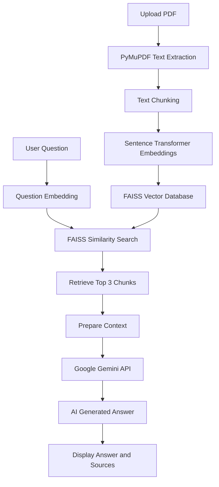
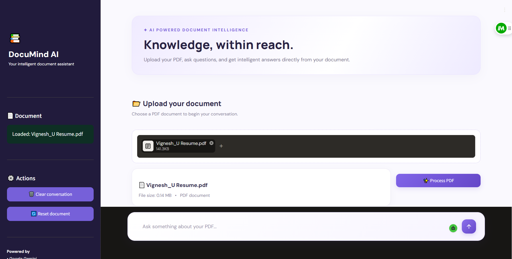
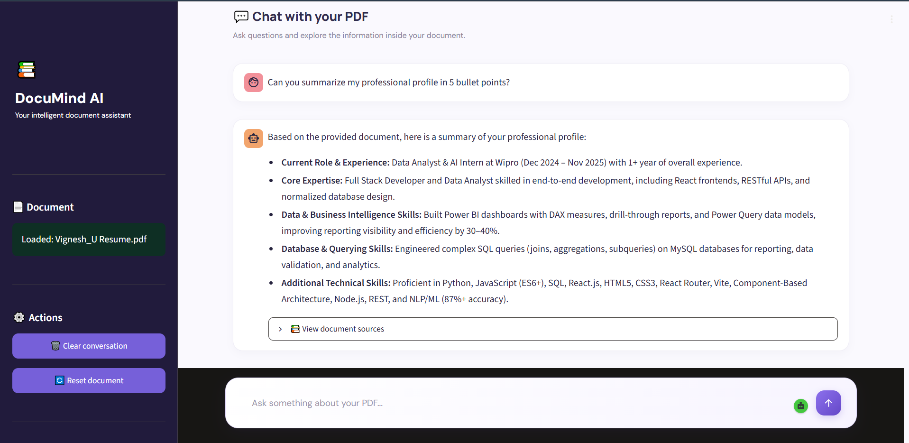

# 📚 DocuMind AI – Intelligent PDF Question Answering System

**Chat with your documents. Understand information. Get intelligent answers.**

DocuMind AI is an AI-powered PDF question-answering application that allows users to upload PDF documents and ask questions in natural language.

Built using **Retrieval-Augmented Generation (RAG)**, Sentence Transformers, FAISS, and Google Gemini, it retrieves relevant information from uploaded documents and generates context-aware answers.

---

## ✨ Features

- 📄 **PDF Text Extraction** – Extract readable text from uploaded PDF documents.
- ✂️ **Intelligent Text Chunking** – Divide large documents into smaller overlapping text chunks.
- 🧠 **Semantic Embeddings** – Convert text into numerical vector representations using Sentence Transformers.
- 🔍 **Vector Search** – Retrieve relevant document chunks using FAISS similarity search.
- 🤖 **AI-Powered Answers** – Generate natural-language responses using Google Gemini.
- 📚 **Source References** – View document chunks used to generate an answer.
- 💬 **Interactive Chat** – Ask multiple questions about uploaded documents.
- 🎨 **Modern UI** – Clean and responsive Streamlit interface.
- 🔄 **Document Management** – Upload a new document or reset the conversation.

---

## 🛠️ Tech Stack

| Technology | Purpose |
|---|---|
| Python | Core programming language |
| Streamlit | Interactive web application |
| PyMuPDF | PDF text extraction |
| Sentence Transformers | Text embeddings |
| all-MiniLM-L6-v2 | Embedding model |
| FAISS | Vector similarity search |
| Google Gemini API | AI answer generation |
| NumPy | Numerical operations |
| python-dotenv | Environment variable management |

---

## 🧠 How It Works – RAG Architecture

DocuMind AI uses **Retrieval-Augmented Generation (RAG)** to answer questions based on uploaded PDF documents.

### Workflow

1. **PDF Upload:** The user uploads a PDF document.
2. **Text Extraction:** PyMuPDF extracts readable text from the document.
3. **Text Chunking:** Extracted text is divided into smaller chunks with overlapping content.
4. **Embedding Generation:** Sentence Transformers converts each chunk into a 384-dimensional vector.
5. **Vector Storage:** FAISS stores the vectors for similarity search.
6. **Question Processing:** The user's question is converted into an embedding.
7. **Context Retrieval:** FAISS retrieves the three most relevant document chunks.
8. **Answer Generation:** Google Gemini generates an answer using the retrieved context.
9. **Source Display:** The application displays the retrieved document chunks for reference.

### Architecture Diagram



---

## 📂 Project Structure

```text
DocuMind-AI/
│
├── src/
│   ├── pdf_processor.py
│   ├── text_chunker.py
│   ├── embedding.py
│   ├── vector_store.py
│   └── gemini_client.py
│
├── data/
│
├── images/
│
├── app.py
├── requirements.txt
├── .gitignore
└── README.md
```

**Note:** The `.env` file is created locally and is excluded from Git using `.gitignore`.

---
## 📸 Application Screenshots

### Application Interface


### AI Chat and Answer

## ⚙️ Installation and Setup

Follow these steps to run DocuMind AI locally.

### 1. Clone the Repository

```bash
git clone https://github.com/21vicky/DocuMind-AI.git
```

### 2. Navigate to the Project Directory

```bash
cd DocuMind-AI
```

### 3. Create a Virtual Environment

```bash
python -m venv venv
```

### 4. Activate the Virtual Environment

**Windows PowerShell:**

```powershell
.\venv\Scripts\Activate.ps1
```

**Windows Command Prompt:**

```cmd
venv\Scripts\activate
```

### 5. Install Dependencies

```bash
pip install -r requirements.txt
```

### 6. Configure the Gemini API Key

Get your API key from [Google AI Studio](https://aistudio.google.com/apikey).

Create a `.env` file in the project root directory.

Add the following:

```env
GEMINI_API_KEY=your_gemini_api_key
```

Replace `your_gemini_api_key` with your actual API key.

**Important:** Never upload your `.env` file or expose your API key publicly.

### 7. Run the Application

```bash
python -m streamlit run app.py
```

The application will open in your browser, usually at:

```text
http://localhost:8501
```

---

## 🚀 Usage

1. Launch the DocuMind AI application.
2. Upload a PDF document.
3. Click **Process PDF**.
4. Wait for text extraction, embedding generation, and vector database creation.
5. Enter a question in the chat input.
6. Receive an AI-generated answer based on your document.
7. Expand the source section to inspect the retrieved text chunks.

---

## 🔬 Core Concepts

### 1. Text Chunking

Large documents are divided into smaller text segments to make information retrieval more effective.

Current configuration:

- Chunk Size: 500 characters
- Chunk Overlap: 100 characters

### 2. Embeddings

The `all-MiniLM-L6-v2` model converts text into numerical vectors.

Each embedding contains **384 dimensions** and represents semantic information from the text.

### 3. FAISS Vector Search

FAISS performs similarity search to identify document chunks relevant to a user's question.

The application uses normalized vectors with inner-product similarity to calculate cosine similarity.

### 4. Retrieval-Augmented Generation (RAG)

RAG combines information retrieval with generative AI.

Instead of relying only on the language model's existing knowledge, DocuMind AI retrieves relevant document content and provides it as context to Gemini.

---

## ⚠️ Current Limitations

- Supports PDF documents only.
- Scanned PDFs without an embedded text layer are not currently supported.
- Answers depend on the quality and content of the uploaded document.
- An active internet connection and valid Gemini API key are required for AI-generated answers.
- Very large documents may require additional processing time.
- Similarity scores are retrieval metrics, not guaranteed answer-confidence percentages.

---

## 🔮 Future Improvements

- [ ] Support multiple PDF documents.
- [ ] Add OCR support for scanned PDFs.
- [ ] Add conversation memory.
- [ ] Implement document summarization.
- [ ] Add downloadable chat history.
- [ ] Support DOCX and TXT files.
- [ ] Deploy with a public application URL.
- [ ] Improve retrieval using advanced RAG techniques.

---

## 👨‍💻 Developer

**Vignesh U**

Full Stack Developer | Python | AI & Data Analytics

- GitHub: [@21vicky](https://github.com/21vicky)
- Project Repository: [DocuMind AI](https://github.com/21vicky/DocuMind-AI)

---

## 📜 License

License information will be added once a license file is included in the repository.